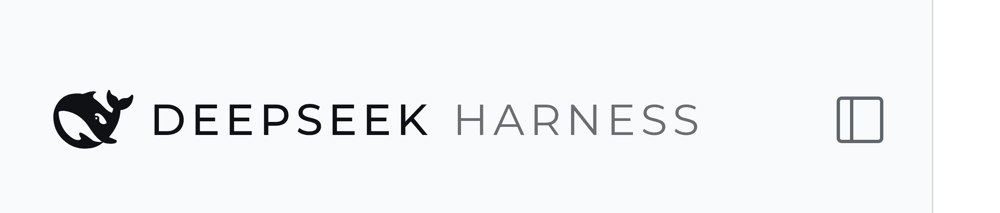
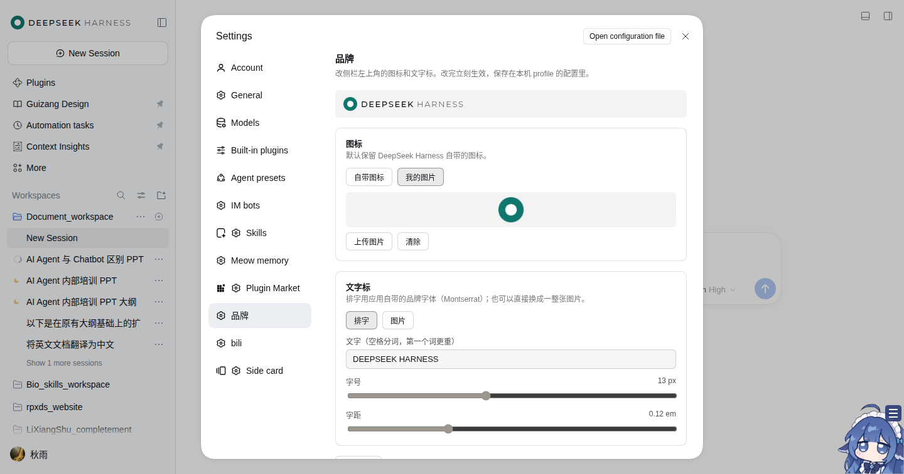

# dsh-brand-logo

Replace the brand row at the top of the DeepSeek Harness sidebar — the whale mark plus the
`DEEPSEEK HARNESS` wordmark — with your own image, or with a wordmark typeset from the font
the app already ships.

No core files are patched and the official brand plugin stays installed; the bundle shadows
the two brand slots and releases them again when you remove it.



## How it works

The side bar row is built from two client slots:

| Slot | What it holds | Owner props |
| --- | --- | --- |
| `sidebar.brand.mark` | the mark on the left (also the only slot rendered in the collapsed rail) | `{ size: number }`, 24 |
| `sidebar.brand.name` | the wordmark on the right | none |

Both are `single` slots, and `@deepseek-ai/dsh-client-ui-brand-official` registers both at the
default priority `0`. This bundle registers the same slots at `priority: -10`; the slot rules
render the lowest priority, so the bundle wins without the official plugin being disabled. The
slot the bundle does not register keeps its shipped content, which is why the two modes below
can leave the whale in place.

## Install

```sh
dsh plugin --profile web add github:squidwantyou/dsh-brand-logo
```

Then restart `dsh web` (a freshly started process reads the client bundle; an already running
one may keep serving the previous module set) and reload the page.

You can also install the checked-out directory through the host's plugin manager, pointing it
at this folder.

Tested with `dsh` 0.2.2-rc.5 (`web` profile). See [Compatibility](#compatibility).

## Use



Open the account menu → **Settings** → **品牌**. Everything there applies immediately and is
saved to your profile — no rebuild, no restart.

- **图标** — keep the shipped whale, or upload your own image. Uploads are downscaled to at
  most 96 px and stored as a PNG data URL in your profile config.
- **文字标** — typeset words, or show a single image:
  - words: 1–3 words, the first solid and the rest lighter (60% opacity by default), 8–20 px,
    tracking 0–0.4 em, in `Montserrat`, the brand font the app already loads;
  - image: rendered at the height you pick (14–32 px), as wide as it needs to be.
- **恢复默认** clears the stored fields and falls back to the shipped `DEEPSEEK HARNESS`.

The values live in the `web` profile's `cordis.patch.yml`, under the row this bundle installs:

```yaml
- id: brand-logo
  name: dsh-brand-logo
  config:
    text: ACME LABS
```

Nothing is baked into the package, so reinstalling or updating it never overwrites your brand.

## What is in the box

```
index.js                  host half: declares the settings schema the Settings page edits
client.js                 compiled browser module: brand slots + Settings page
cordis.patch.yml          inserts the bundle into the loader
tools/build.mjs           rebuilds client.js from the template
tools/client.template.js  page and component source
tools/lib/client-build.mjs  small writer shared by the build
locale/en.json            plugin metadata (title, description, detail doc)
locale/zh.json
icon.svg                  plugin row icon
assets/                   screenshots and the raster plugin icon
docs/DETAIL.md            the long-form plugin detail page
```

To change the page itself, edit `tools/client.template.js`, run `node tools/build.mjs` and
reload the page — the client HMR watcher picks up a rebuilt bundle, and a restart of `dsh web`
always does.

## Compatibility

Built and tested against `dsh` 0.2.2-rc.5. It depends on the client slot system
(`sidebar.brand.mark` and `sidebar.brand.name`, `priority` shadowing for `single` slots), the
client settings service (`ctx.configForms` and the `settings.section` slot), and
`--dsw-font-family-brand` for the default typesetting. If a future release renames the slots
the bundle simply stops matching and the shipped brand returns; if the settings service moves,
the page reports that the config is not writable and the shipped defaults stay in use.

## Uninstall

Remove the bundle through the host's plugin manager (or `dsh plugin --profile web remove
dsh-brand-logo`) and restart. The official brand row comes back on its own.

## License

MIT
