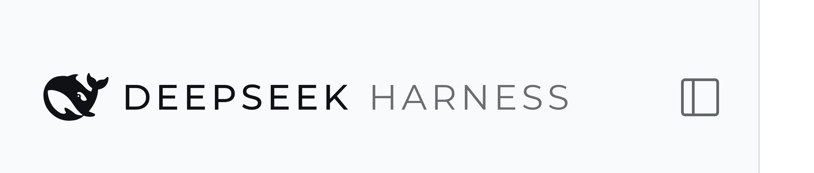
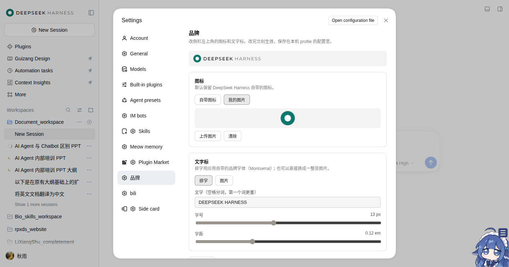

# dsh-brand-logo

把 DeepSeek Harness 侧栏顶部的品牌行 —— 鲸鱼图标加 `DEEPSEEK HARNESS` 文字 —— 换成你自己的图片，
或者用应用自带字体排一段字标。

不改官方任何文件，也不禁用官方品牌插件：插件以更低的 priority 占用品牌槽位，卸载后官方内容自动回来。



## 原理

侧栏这一行由两个客户端槽位（slot）拼成：

| 槽位 | 内容 | owner props |
| --- | --- | --- |
| `sidebar.brand.mark` | 左侧图标（侧栏折叠成 rail 时只渲染这个槽位） | `{ size: number }`，24 |
| `sidebar.brand.name` | 右侧文字 | 无 |

两个都是 `single` 槽位，官方 `@deepseek-ai/dsh-client-ui-brand-official` 以默认 priority `0`
占着它们。本插件用 `priority: -10` 注册同名槽位，槽位规则取最小 priority，因此不需要停用官方插件。
插件没有注册的那个槽位保持官方内容 —— 所以下面两种模式下都能把鲸鱼图标留着。

## 安装

```sh
dsh plugin --profile web add github:squidwantyou/dsh-brand-logo
```

装完**重启 `dsh web`**（新进程才会读到新的客户端 bundle；老进程可能还在发旧的模块集），然后刷新页面。

也可以用宿主自带的插件管理器，指向这个目录以 bundle 方式安装。

已在 `dsh` 0.2.2-rc.5（`web` profile）上验证。见[兼容性](#兼容性)。

## 使用



打开左下角账户菜单 → **设置（Settings）** → **品牌**。这一页改完立刻生效、直接存进 profile，不用重新构建、不用重启。

- **图标** — 「自带图标」保留官方鲸鱼，直接用官方插件自己的组件渲染，官方换图也能跟上；「我的图片」上传自己的图，
  浏览器里压到最长边 96px，再以 PNG data URL 存进配置。
- **文字标** — 「排字」排 1–3 个词，第一个词实心、后面的词更淡（默认 60% 不透明度），字号 8–20px、字距 0–0.4em，
  字体是应用自带的 `Montserrat`；「图片」则整张图替换文字标，高度 14–32px，宽度按原图比例。
- **恢复默认** — 清掉存下的字段，回到官方 `DEEPSEEK HARNESS`。

存下来的值就在 `web` profile 的 `cordis.patch.yml` 里，插件自己那一行下面：

```yaml
- id: brand-logo
  name: dsh-brand-logo
  config:
    text: ACME LABS
```

值没有编进包里，所以升级或重装插件都不会覆盖你设的品牌。

## 目录结构

```
index.js                 宿主半边：声明设置页要编辑的配置 schema
client.js                编译后的浏览器模块：品牌槽位 + 设置页
cordis.patch.yml         把 bundle 插进 loader
tools/build.mjs          从模板重新生成 client.js
tools/client.template.js 设置页与组件的源码
tools/lib/client-build.mjs  构建用的写入小工具
locale/en.json           插件元信息（标题、描述、详情文档）
locale/zh.json
icon.svg                 插件行图标
assets/                  截图与插件图标
docs/DETAIL.md           插件详情页长文
```

想改设置页本身，改 `tools/client.template.js`，跑 `node tools/build.mjs` 再刷新页面 ——
客户端的 HMR watcher 会重新加载重建后的 bundle；重启 `dsh web` 则一定生效。

## 兼容性

针对 `dsh` 0.2.2-rc.5 构建并验证。依赖客户端槽位体系（`sidebar.brand.mark` / `sidebar.brand.name`、
`single` 槽位的 priority 遮蔽规则）、客户端设置服务（`ctx.configForms` 与 `settings.section` 槽位），
以及默认排版用的 `--dsw-font-family-brand` 变量。未来版本要是改了槽位名，插件只是不再命中、官方品牌自动恢复；
设置服务要是变了，设置页会提示「当前不可写」，品牌行继续用官方默认。

## 卸载

用宿主插件管理器移除（或 `dsh plugin --profile web remove dsh-brand-logo`），重启即可。
官方品牌行会自动回来。

## 许可

MIT
