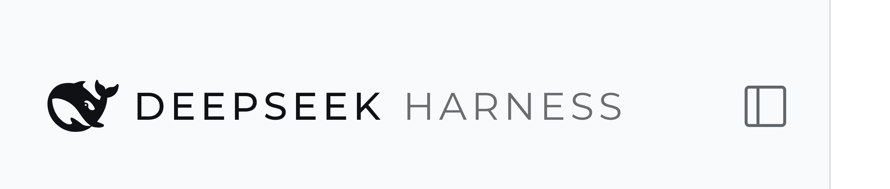

# Brand logo

Replace the brand row at the top of the DeepSeek Harness sidebar — the whale mark and the
`DEEPSEEK HARNESS` wordmark — with an image of your own, or with a wordmark typeset in the
font the app already ships. Everything is edited from **Settings → 品牌** and applies live.



## What it touches

Nothing in the core. The row is assembled from two client slots, and the bundle claims the
same slots the official brand plugin claims, one priority step lower:

| Slot | Rendered in | Registered by this bundle |
| --- | --- | --- |
| `sidebar.brand.mark` | the 24 px square on the left, also the only slot drawn when the sidebar is collapsed to a rail | always |
| `sidebar.brand.name` | the wordmark on the right | always |

The official plugin registers both at priority `0`. A `single` slot renders the lowest
priority entry, so registering at `-10` shadows it without disabling it. Each claim decides
per render what to show: the shipped whale, a wordmark, or an uploaded image.

Because the claim is a slot registration rather than a file patch, removing the bundle hands
the row straight back to the official plugin.

## The default: a typeset wordmark

`DEEPSEEK` sits at weight 500, `HARNESS` at weight 400 with 60% opacity, 13 px on a 0.12 em
tracking, in `Montserrat` — the brand font the theme already loads, referenced through
`var(--dsw-font-family-brand)` so it follows the app's typography. The whale is untouched.

## Customising

Open the account menu → **Settings** → **品牌**. Every control writes through the host's
settings service and the row redraws immediately:

- **图标** — `自带图标` keeps the shipped whale (rendered from the official plugin's own
  component, so it stays correct if the artwork changes); `我的图片` takes an upload.
- **文字标** — `排字` typesets one to three words; `图片` shows a single image instead, at the
  height you choose.
- **恢复默认** unsets the fields, which removes the config row entirely.

Uploads are read in the browser: the file is downscaled to at most 96 px and re-encoded as a
PNG data URL, so the stored value carries no path and never depends on a file staying put. A
value above 200 000 characters is rejected with a message rather than silently truncated.

## Where the settings live

The namespace is the bundle's row id, `brand-logo`, so the values are ordinary profile
settings — written to the `web` profile's `cordis.patch.yml`:

```yaml
- id: brand-logo
  name: dsh-brand-logo
  config:
    text: ACME LABS
    size: 14
```

Nothing is compiled into the package, so updating the plugin never overwrites your brand. The
fields are declared `volatile` on the host side; that is what makes the host expose them as an
editable form.

## Troubleshooting

- **The page says 当前不可写.** The host's settings service could not describe the namespace —
  usually because the bundle is not the enabled one, or the running `dsh` predates the
  settings API. The row keeps using the shipped defaults; reload after a restart.
- **Row still shows the old brand.** The client module is cached per page; reload, and if that
  is not enough restart the `dsh web` process.
- **`single slot "sidebar.brand.name" already has a registration`.** Two copies of this
  bundle are enabled at the same priority. Keep one.
- **Text is clipped on a narrow window.** The row has roughly 180 px for the wordmark next to
  the collapse button; shorten the text, drop the size, or upload a narrower image.
- **An upload is refused.** The encoded value exceeded 200 000 characters — use a smaller or
  more tightly cropped image.
